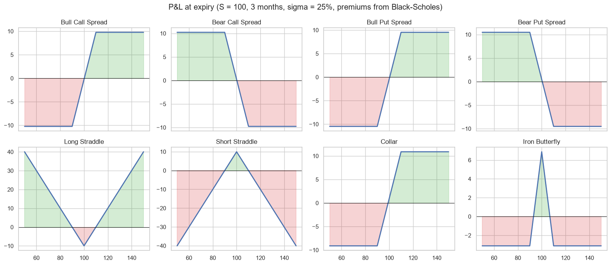
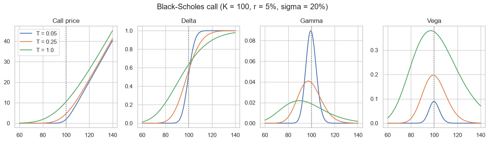

# Black-Scholes and option strategies calculators

Two calculators I made for the Derivatives course at Universidad EIA, now in English:

- `black_scholes_calculator.ipynb`: price and Greeks of European options (with dividend yield), automatic interpretation of the Greeks, ITM/ATM/OTM, and checks (Hull example 10.4506, put-call parity, and each Greek against the numerical derivative).
- `option_strategies_calculator.ipynb`: P&L at expiry, maximum profit and loss, net premium and break-evens of 8 structures (bull/bear spreads, straddles, collar, iron butterfly), with premiums from Black-Scholes.

In this second version I corrected the Bear Put Spread (the first version had the legs inverted), the collar now includes the stock, and the break-evens are found where the P&L changes sign.




## How to run

```
pip install -r requirements.txt
jupyter notebook
```

---
Alejandro Lezcano Osorio | Universidad EIA (Colombia) and Rennes School of Business (France)
